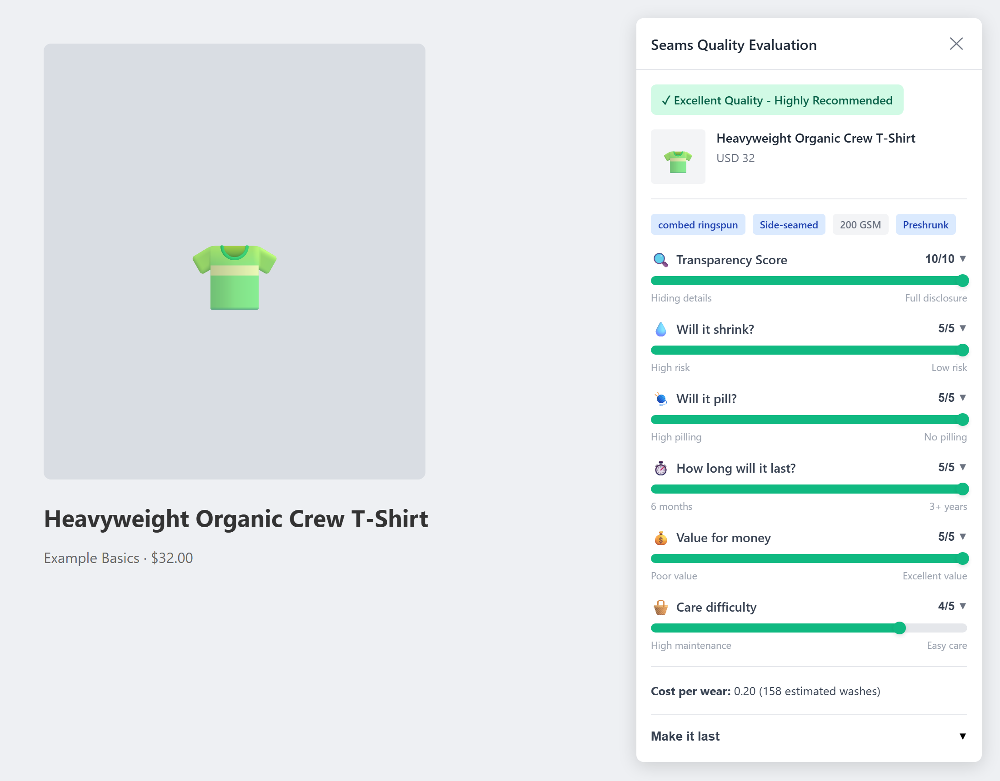

# Seams

[](https://github.com/gibbon-4-code/seams/actions/workflows/tests.yml)  [](LICENSE)

**A Chrome extension and Python engine that reads a clothing product page and tells you whether the garment will actually last.**

Price is a poor signal of quality. A 2025 University of Leeds / WRAP study tested 47 t-shirts and found a £4 shirt outlasting a £395 one, with the most durable costing £28. What *does* predict durability is things like cotton type, fabric weight, yarn count and construction. Retailers often bury these details in the description, or leave them out entirely.

Seams pulls those details out of the page, scores the garment on durability, shrinkage, pilling, value and care, and shows the result as an overlay while you shop.



> **Status: archived.** Seams was a personal project built in early 2026. It works end-to-end locally (extension → API → extraction → scoring) for t-shirts, hoodies and jeans, but it isn't published to the Chrome Web Store and isn't under active development.

---

## How it works

```
 Product page (any retailer)
          │  page HTML
          ▼
 ┌──────────────────────┐      POST /api/evaluate      ┌──────────────────────────┐
 │  Chrome extension    │ ───────────────────────────► │  FastAPI backend         │
 │  (MV3)               │                              │  api/server.py           │
 │  • detects product   │ ◄─────────────────────────── │                          │
 │    pages             │      scores + explanations   │  1. product_extractor    │
 │  • renders overlay   │                              │  2. materials_parser     │
 └──────────────────────┘                              │  3. garment_detector     │
                                                       │  4. tshirt / hoodie /    │
                                                       │     jeans evaluator      │
                                                       └──────────────────────────┘
```

### 1. Extraction (`tools/product_extractor.py`)

Retailers structure their pages very differently, so extraction tries several strategies in order and records which one worked:

1. **JSON-LD**: schema.org `Product` / `Offer` data
2. **JavaScript config**: site-specific embedded state (e.g. ASOS)
3. **OpenGraph / meta tags**
4. **Heuristics**: keyword search through visible text

Every result carries `extraction.method`, a `confidence` level and a list of `notes`. If extraction partly fails, you get partial output and an explanation rather than a crash.

### 2. Materials parsing (`tools/materials_parser.py`)

Turns free text like `Shell: 60% Wool, 40% Polyester. Lining: 100% Polyester` into structured parts, materials and percentages. It normalises synonyms (viscose → rayon, elastane → spandex) and flags totals that don't add up to 100%.

### 3. Garment detection and scoring (`tools/*_evaluator.py`)

A regex-based detector routes each product to a garment-specific evaluator. Each evaluator encodes domain research as explicit, testable rules:

| Garment | What it looks at |
|---|---|
| **T-shirts** | Cotton type hierarchy (Supima/Pima → combed ring-spun → carded), GSM sweet spot (165–185, not "heavier = better"), singles count, side-seaming vs. tubular, the 65/35 poly-cotton pilling red flag |
| **Hoodies** | Hoodie-specific GSM thresholds, fleece type, hood/zip/cuff construction, brand sub-lines (e.g. Champion Reverse Weave vs. Powerblend) |
| **Jeans** | Denim weight (oz), elastane % (stretch-out risk), selvedge, chain stitching, rivets, fade potential |

Each evaluator returns:

- 1–5 scores with a plain-English explanation for each
- an overall tier
- a **transparency score**: how much the retailer actually disclosed
- estimated washes and **cost-per-wear**
- warnings
- "ask customer service" questions for missing specs

Price is deliberately capped as a signal.

<details>
<summary>Example evaluator output</summary>

```json
{
  "scores": { "longevity": 5.0, "shrinkage": 5.0, "pilling": 5.0, "value": 5.0, "care": 4.0 },
  "overall_score": 99.0,
  "quality_tier": "excellent",
  "transparency_score": 10,
  "estimated_washes": 158,
  "cost_per_wear": 0.2,
  "warnings": [],
  "ask_customer_service": []
}
```
</details>

---

## Running it

Requires Python 3.11+.

```bash
pip install -r requirements.txt
```

**Tests** (225 tests, no network access needed; all HTML fixtures are embedded):

```bash
pytest
```

**CLI**: extract product data from a URL or a saved page:

```bash
python cli.py --html-file saved_page.html
python cli.py --url "https://www.example.com/product/123"
```

**Evaluator only**: score a product from JSON:

```bash
python -m tools.tshirt_evaluator --json-file product.json
```

**Extension + API**:

```bash
python api/server.py          # serves http://localhost:8000
```

Then load the `extension/` folder at `chrome://extensions` (Developer mode → *Load unpacked*) and open a product page. See [extension/README.md](extension/README.md) for details.

---

## Project layout

```
api/          FastAPI backend the extension talks to
extension/    Chrome MV3 extension (product detection + overlay UI)
tools/        Extraction, materials parsing, garment detection, evaluators
tests/        Unit + end-to-end tests with embedded HTML fixtures
workflows/    Markdown SOPs describing each pipeline step
cli.py        Command-line entry point for extraction
```

The repo was built with an AI coding agent using a "Workflows, Agents, Tools" structure. The deterministic logic lives in `tools/`, `workflows/` holds a step-by-step SOP for each stage, and [Claude.md](Claude.md) holds the agent's operating rules: one URL at a time, no live network calls in tests, return partial results instead of crashing.

## Responsible use

Seams is designed for evaluating one page at a time while you browse. It does not crawl, bypass paywalls or logins, or get around bot detection. URL mode uses polite timeouts and a clear User-Agent. If a site blocks it, save the page from your browser and use `--html-file`.

## Limitations and what I'd do next

- Only t-shirts, hoodies and jeans are scored. Other garments fall back to the t-shirt evaluator.
- The scoring rules are hand-tuned from published research and brand knowledge, not trained on lab-tested outcomes.
- The API runs locally; the extension expects `localhost:8000`.
- Next steps would have been: jackets and knitwear evaluators, retailer-specific extractors for the biggest UK sites, and caching results per URL.

## License

[MIT](LICENSE)
